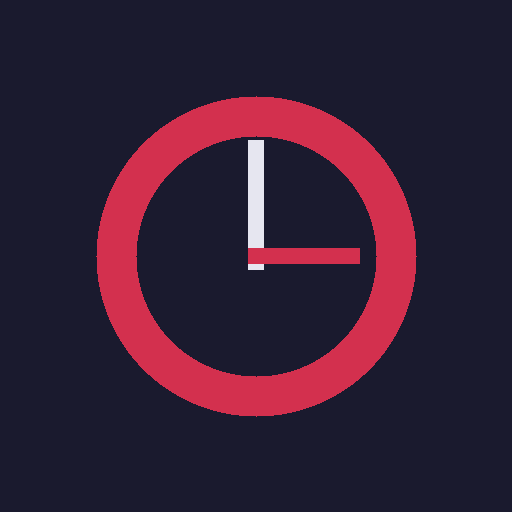
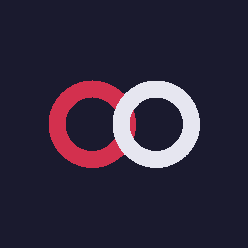
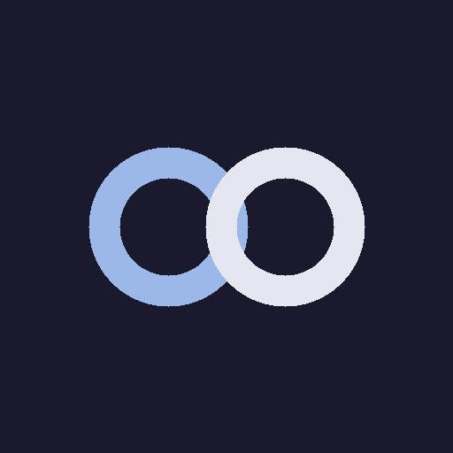
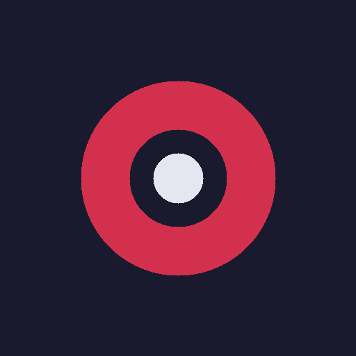

<!-- argus:profile-readme -->

## About

Software developer from Puerto Rico. I turn messy workflows into systems
people can run, monitor, and improve — a living portfolio of skills across
automation, Android/desktop apps, and FOSS tooling.

## Focus

<table>
<tr>
<td width="25%" valign="top" align="center">
<strong>Problem Solver</strong> 
Turning complex workflows into clear, maintainable solutions.
</td>
<td width="25%" valign="top" align="center">
<strong>Builder</strong> 
Shipping tools people can run every day.
</td>
<td width="25%" valign="top" align="center">
<strong>Automator</strong> 
Removing repetitive work with CI, bots, and scheduled systems.
</td>
<td width="25%" valign="top" align="center">
<strong>Privacy-minded</strong> 
Preferring local-first, FOSS, and data-respectful designs.
</td>
</tr>
</table>

## What I build

<table>
<tr>
<td width="16%" valign="top" align="center">
<strong>Mobile apps</strong> 
Android and cross-platform apps with clear UX and local vaults when needed.
</td>
<td width="16%" valign="top" align="center">
<strong>Automation systems</strong> 
Scheduled work, validation, sync, bots, and background processing.
</td>
<td width="16%" valign="top" align="center">
<strong>Web and APIs</strong> 
Maintainable backends, PWAs, and clean integrations.
</td>
</tr><tr>
<td width="16%" valign="top" align="center">
<strong>Desktop and systems</strong> 
Local utilities for Windows, Linux, and developer workflows.
</td>
<td width="16%" valign="top" align="center">
<strong>Internal tools</strong> 
Ops, auditing, configuration, and access-friendly admin surfaces.
</td>
<td width="16%" valign="top" align="center">
<strong>Data and reporting</strong> 
Import, transform, and present structured information safely.
</td>
</tr>
</table>

## Featured projects

<table>
<tr>
<td align="center" valign="top" width="14%">
 
<a href="https://github.com/edwardlthompson/DevPulse">DevPulse</a>
 
 3
·
 0
·
 0

</td>
<td align="center" valign="top" width="14%">
 
<a href="https://github.com/edwardlthompson/point-and-shoot">point-and-shoot</a>
 
 3
·
 0
·
 0

</td>
<td align="center" valign="top" width="14%">
 
<a href="https://github.com/edwardlthompson/trendalgo-bot">trendalgo-bot</a>
 
 1
·
 0
·
 0

</td>
<td align="center" valign="top" width="14%">
 
<a href="https://github.com/edwardlthompson/agent-project-bootstrap">agent-project-bootstrap</a>
 
 1
·
 0
·
 0

</td>
<td align="center" valign="top" width="14%">
 
<a href="https://github.com/edwardlthompson/HermesLauncher">HermesLauncher</a>
 
 1
·
 0
·
 0

</td>
<td align="center" valign="top" width="14%">
 
<a href="https://github.com/edwardlthompson/lineage-lens">lineage-lens</a>
 
 0
·
 0
·
 0

</td>
<td align="center" valign="top" width="14%">
 
<a href="https://github.com/edwardlthompson/continuum-calendar">continuum-calendar</a>
 
 0
·
 0
·
 0

</td>
</tr>
<tr>
<td align="center" valign="top" width="14%">
 
<a href="https://github.com/edwardlthompson/OBDForge">OBDForge</a>
 
 0
·
 0
·
 0

</td>
<td align="center" valign="top" width="14%">
 
<a href="https://github.com/edwardlthompson/AstroAlarm">AstroAlarm</a>
 
 0
·
 0
·
 0

</td>
<td align="center" valign="top" width="14%">
 
<a href="https://github.com/edwardlthompson/OpenShouter">OpenShouter</a>
 
 0
·
 0
·
 0

</td>
<td align="center" valign="top" width="14%">
 
<a href="https://github.com/edwardlthompson/chromaflow">chromaflow</a>
 
 0
·
 0
·
 0

</td>
<td align="center" valign="top" width="14%">
 
<a href="https://github.com/edwardlthompson/QuickMediaIngest">QuickMediaIngest</a>
 
 0
·
 0
·
 0

</td>
<td align="center" valign="top" width="14%">
 
<a href="https://github.com/edwardlthompson/aetherfeed">aetherfeed</a>
 
 0
·
 0
·
 0

</td>
<td align="center" valign="top" width="14%">
 
<a href="https://github.com/edwardlthompson/QRaft">QRaft</a>
 
 0
·
 0
·
 0

</td>
</tr>
<tr>
<td align="center" valign="top" width="14%">
 
<a href="https://github.com/edwardlthompson/MultiAppShare-">MultiAppShare-</a>
 
 0
·
 0
·
 0

</td>
<td align="center" valign="top" width="14%">
 
<a href="https://github.com/edwardlthompson/SyncMark">SyncMark</a>
 
 0
·
 0
·
 0

</td>
<td align="center" valign="top" width="14%">
 
<a href="https://github.com/edwardlthompson/JanusBoot">JanusBoot</a>
 
 0
·
 0
·
 0

</td>
<td align="center" valign="top" width="14%">
 
<a href="https://github.com/edwardlthompson/linkslander-edwardlthompson">linkslander-edwardlthompson</a>
 
 0
·
 0
·
 0

</td>
<td align="center" valign="top" width="14%">
 
<a href="https://github.com/edwardlthompson/ExpeditionGauge">ExpeditionGauge</a>
 
 0
·
 0
·
 0

</td>
<td align="center" valign="top" width="14%">
 
<a href="https://github.com/edwardlthompson/vault-organizer">vault-organizer</a>
 
 0
·
 0
·
 0

</td>
<td align="center" valign="top" width="14%">
 
<a href="https://github.com/edwardlthompson/selfchronicle">selfchronicle</a>
 
 0
·
 0
·
 0

</td>
</tr>
<tr>
<td align="center" valign="top" width="14%">
</td>
<td align="center" valign="top" width="14%">
 
<a href="https://github.com/edwardlthompson/3d-game-optimizer">3d-game-optimizer</a>
 
 0
·
 0
·
 0

</td>
<td align="center" valign="top" width="14%">
 
<a href="https://github.com/edwardlthompson/Google-Messages-For-Desktop">Google-Messages-For-Desktop</a>
 
 0
·
 0
·
 0

</td>
<td align="center" valign="top" width="14%">
 
<a href="https://github.com/edwardlthompson/screen-wakelock-detector">screen-wakelock-detector</a>
 
 0
·
 0
·
 0

</td>
<td align="center" valign="top" width="14%">
 
<a href="https://github.com/edwardlthompson/takein-sms">takein-sms</a>
 
 0
·
 0
·
 0

</td>
<td align="center" valign="top" width="14%">
 
<a href="https://github.com/edwardlthompson/Argus">Argus</a>
 
 0
·
 0
·
 0

</td>
<td align="center" valign="top" width="14%">
</td>
</tr>
</table>

## Tech stack

### Languages

### Mobile and apps

### Automation and tools

### Web and data

## Current focus

<table>
<tr>
<td width="50%" valign="top" align="center">
<strong>Portfolio hygiene</strong> 
Keeping public Overview and FOSS apps aligned with live evidence via Argus.
</td>
<td width="50%" valign="top" align="center">
<strong>Local-first apps</strong> 
Android and desktop tools that respect privacy and work offline.
</td>
</tr>
</table>

## Development principles

> Build for real users. Protect data integrity. Automate repetitive work. Prefer FOSS, local-first, and maintainable solutions.

## Also open to

<table>
<tr>
<td width="25%" valign="top" align="center">
<strong>Software development</strong> 
Practical builds across automation, apps, and FOSS tooling.
</td>
<td width="25%" valign="top" align="center">
<strong>Automation</strong> 
Scheduled systems, bots, CI, and workflow cleanup.
</td>
</tr><tr>
<td width="25%" valign="top" align="center">
<strong>FOSS collaboration</strong> 
Issues, PRs, and shared maintainership on MIT-licensed work.
</td>
<td width="25%" valign="top" align="center">
<strong>Clean secure apps</strong> 
Local vaults, clear UX, and maintainable architecture.
</td>
</tr>
</table>

---

_Updated by [Argus](https://github.com/edwardlthompson/Argus). Marker: `argus:profile-readme`._